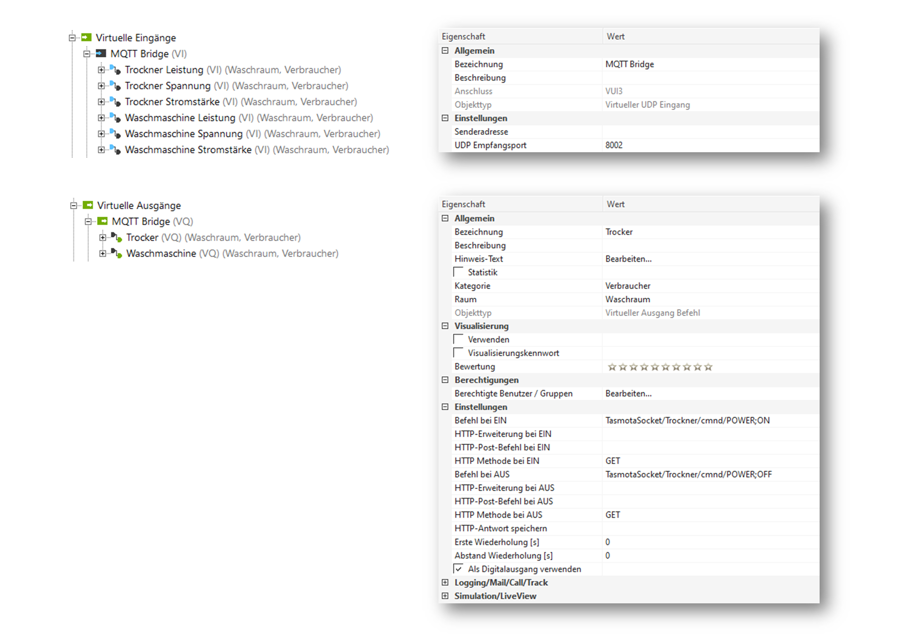
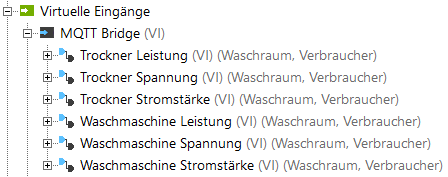
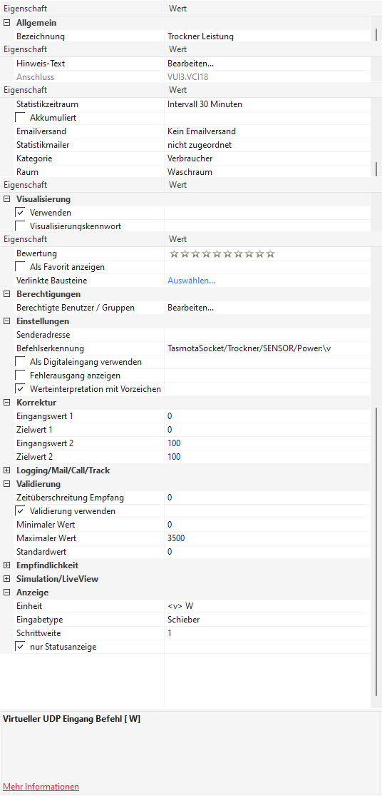

# LxMqttBridge

standalone MQTT Bridge optimized for Tasmota sockets with full integration in Loxone smart home

The bridge connects two worlds in both directions:

- **MQTT → Loxone:** messages from subscribed MQTT topics are transformed and sent to Loxone via UDP.
- **Loxone → MQTT:** UDP messages from Loxone ("topic;payload") are published to the MQTT broker.



## How it works

### MQTT → Loxone

The bridge subscribes to the topics configured under `mqttBroker.subscriptions` and applies the
configured mapping rules (`mappings`) to every received message. Resulting messages are sent as
UDP packets to the Miniserver.

Built-in mapping type `tasmota-energy`:

```
topic: TasmotaSocket/Waschmaschine/SENSOR
payload: {"Time":"...","ENERGY":{"Total":12.34,"Power":123.4,"Voltage":230.1,"Current":0.56,...}}
```

is transformed into three Loxone messages (only fields that are actually present are sent):

```
TasmotaSocket/Waschmaschine/SENSOR/Power:123.4
TasmotaSocket/Waschmaschine/SENSOR/Voltage:230.1
TasmotaSocket/Waschmaschine/SENSOR/Current:0.56
```

### Loxone → MQTT

Messages received from Loxone must have the form `topic;payload` and are published 1:1 to the MQTT
broker (e.g. `TasmotaSocket/Waschmaschine/Relay1;ON`).

### MQTT topics used

- `<topic>/connected` – status (`2` while running, `0` via retained last-will after unexpected disconnect)
- `<topic>/set/#` – incoming commands to the bridge world

## Installation

```sh
npm install
```

Copy `config.example.json` to `config.json` and adjust it:

```json
{
    "logLevel": "debug",
    "mqttBroker": {
        "url": "mqtt://your-mqtt-broker.local:1883",
        "topic": "Loxone-W2",
        "username": "",
        "password": "",
        "tlsVerify": true,
        "subscriptions": [
            "TasmotaSocket/Waschmaschine/SENSOR/#",
            "TasmotaSocket/Trockner/SENSOR/#"
        ]
    },
    "loxone": {
        "host": "your-loxone-miniserver.local",
        "port": 8002
    },
    "mappings": [
        { "type": "tasmota-energy", "topicSuffix": "SENSOR" }
    ]
}
```

`config.json` is **not** stored in git - take `config.example.json` as template.

## Run

```sh
npm start
```

or with a specific config file:

```sh
node build/bridge.js /path/to/config.json
```

### Environment variable overrides

For Docker deployments the config file can be overridden with environment variables:

| Variable          | Meaning                                   |
|-------------------|-------------------------------------------|
| `BRIDGE_CONFIG`   | path to the config file                   |
| `LOG_LEVEL`       | `logLevel`                                |
| `MQTT_URL`        | `mqttBroker.url`                          |
| `MQTT_USERNAME`   | `mqttBroker.username`                     |
| `MQTT_PASSWORD`   | `mqttBroker.password`                     |
| `MQTT_TLS_VERIFY` | `mqttBroker.tlsVerify` (`false` disables) |
| `LOXONE_HOST`     | `loxone.host`                             |
| `LOXONE_PORT`     | `loxone.port`                             |

## Loxone configuration (Virtual UDP Input)

On the Miniserver, create a *Virtual UDP Input* (see `documentation/images`):



Port must match `loxone.port` (default `8002`). Then create *Command Inputs* for each field:



## Docker

The image is built automatically via GitHub Actions
(`docker-image.yml` → `arminradmueller/lxmqttbridge:latest`):

```sh
docker run -v $(pwd)/config.json:/opt/bridge/config.json arminradmueller/lxmqttbridge:latest
```

Optionally use environment variables instead of mounting a config file. The container runs as
non-root user (`node`).

## Development

```sh
npm run dev       # start with nodemon + ts-node
npm run lint      # eslint
npm test          # build + run unit tests
```

Unit tests live in `test/`. The message transformation logic is kept in `transform.ts` as pure,
testable functions.

## License

MIT - see [LICENSE](LICENSE)
